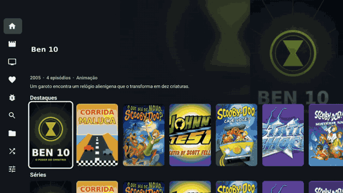
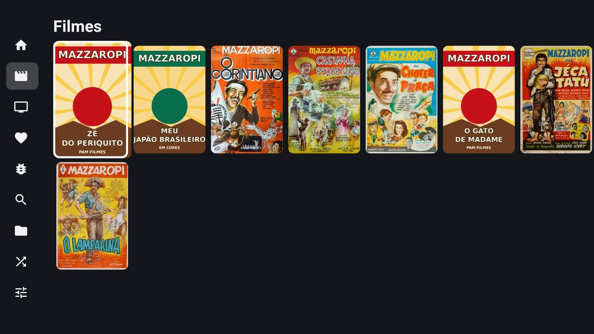
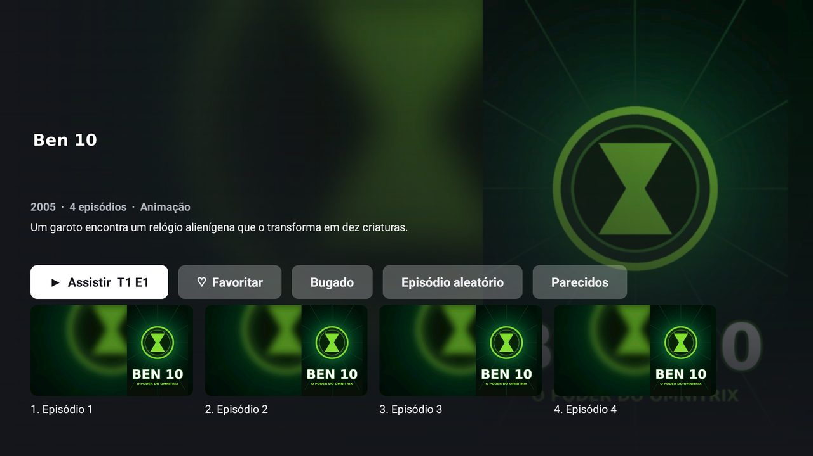
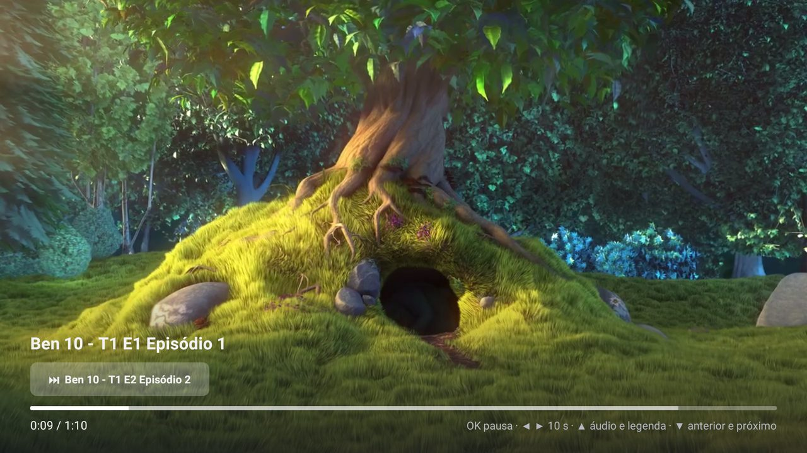
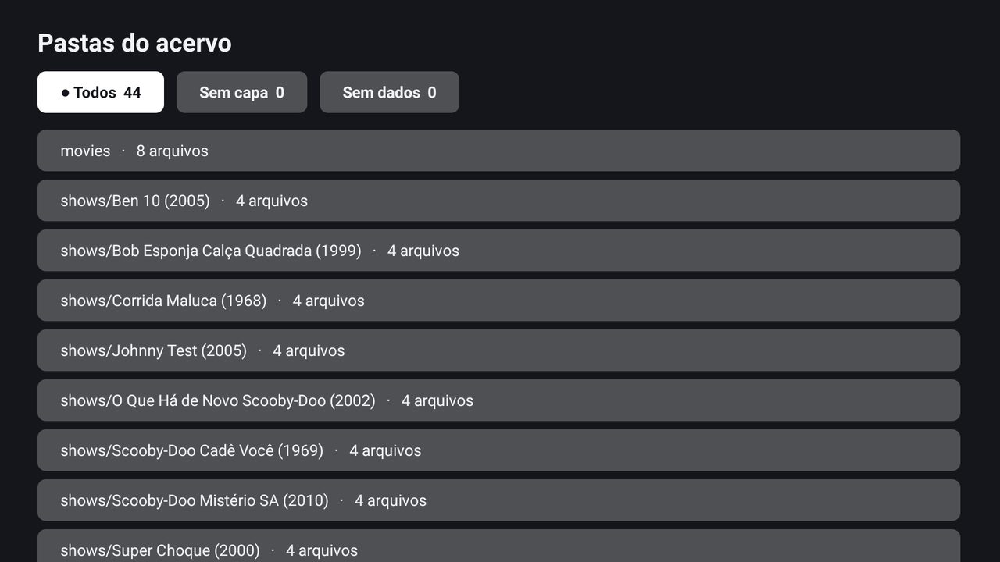
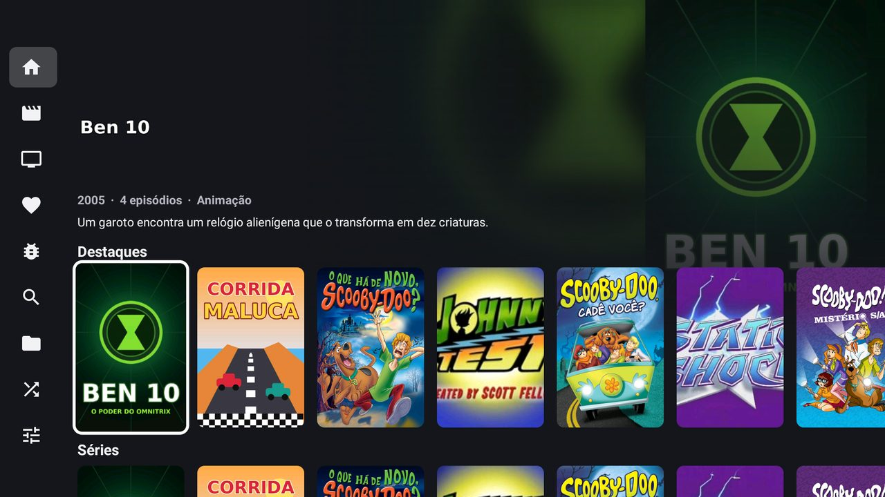
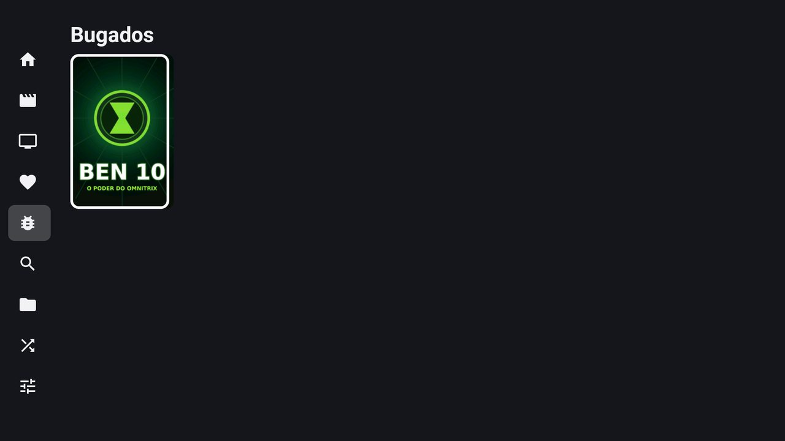
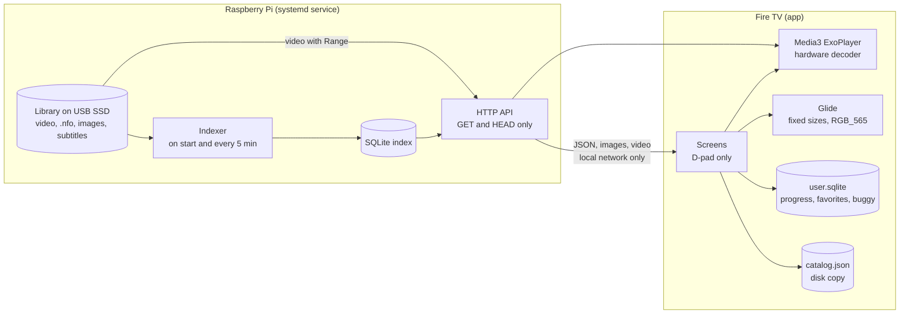

<div align="center">

# Media LAN

**A small media server for a Raspberry Pi and a TV app for Fire TV: movies and shows over the local network, with no transcoding and no internet.**


<br>



<sub>A sample built with classic cartoons and old Brazilian comedies. See <a href="#screenshots">Screenshots</a>.</sub>

</div>

## About

The server only delivers data: the catalog as JSON, video with `Range`, images and subtitles. Search, progress and
everything else that belongs to the user live in the app, so the server has no write route at all: only `GET` and `HEAD`.

It reads a library folder, builds a SQLite index from the `.nfo` files and images written by tinyMediaManager, and
reindexes on start and every 5 minutes. A video without a `.nfo` still appears, under its file name. Nothing is
transcoded, so the library must already be in formats the device plays directly.

## Screenshots

**This is only an example, not a library that ships with the project.** The walkthrough and the screenshots use a mock
library of classic cartoons (Scooby-Doo, Johnny Test, Super Choque, SpongeBob, X-Men: Evolution, Ben 10, Wacky Races)
and Mazzaropi comedies. It is the real app on an Android TV emulator against the real server, but no real episode is
shown: every title plays the same short clip of [Big Buck Bunny](https://peach.blender.org/) (CC BY 3.0, Blender
Foundation). Some covers were designed for this demo, and the rest belong to their respective owners. The repository
contains no videos or cover files, only these captures, and the project does not provide any content.

To record your own, point the scripts at a library folder:

```bash
python3 android/e2e/record_gif.py /path/to/library    # docs/demo.gif
python3 android/e2e/screenshots.py /path/to/library   # docs/screenshots
```

Without a folder they use the fictional library from `demo/make_library.py`, which is also what the tests run on.

| | |
|---|---|
|  |  |
| Movies, in an order that changes by hour or by day | Detail with similar titles |
|  |  |
| Player built for a remote | Folders, with filters for what has no cover or no data |
|  |  |
| Home, with the featured title on top | Buggy list, for titles to review later |

## Architecture



What this design needs to work:

- The server and the TV on the same local network, with the Pi at a fixed address.
- Videos already in a codec, resolution and bitrate the TV device plays directly.
- A library laid out as shown below. tinyMediaManager is optional, but it provides the metadata and images.
- Python 3.11 on the Pi, with no other dependency. The disk mounted at a stable path.

Item ids come from the relative file path. Renaming a file creates a new id, and the app loses that item's progress.

## Limitations

- **No transcoding.** A file the device cannot play directly stays unplayable.
- **No login and no HTTPS.** Any device on the allowed network can read the whole library.
- **Local network only.** There is no access from outside the house, by design.
- **One user per device.** Progress and favorites live on each TV and are not shared between devices.
- **Periodic indexing.** New or removed files appear after the next scan, up to 5 minutes later by default.
- **The emulator is an estimate.** Its video decoder is software and its GPU is the host's, so smoothness and codec support are only proven on a real device.
- **Fire TV home screen.** The app does not replace the Amazon launcher or remove its ads. Sideloaded apps also get a square icon with grey side bars in the app grid: `android:banner` and wide icons were tested and do not change that.
- **Changing the icon of an installed app.** The Amazon launcher caches the image by package name, so a new icon needs a new `applicationId`, which starts with empty user data.
- **Interface language.** The app screens are in Brazilian Portuguese.

## Set up on a new PC

You need SSH with `sudo` on a Pi with Python 3.11 or newer, and the Android SDK to build the app.

```bash
git clone <this repository> media-lan
cd media-lan
python3 -m unittest discover -s tests
./install.sh user@pi-address
curl http://pi-address:8097/api/health
MEDIA_LAN_SERVER=http://pi-address:8097 android/build.sh release
adb connect fire-tv-address:5555
adb install -r android/app/build/outputs/apk/release/app-release.apk
```

The disk must be in `fstab` at `/media/ssd`. If your network is not `192.168.0.0/24`, change `MEDIA_LAN_NETWORKS` and
`IPAddressAllow` in `server/media-lan.service`. The only data outside the repository is the index in
`/var/lib/media-lan`, and it is rebuilt by itself. The app address can also be changed in its settings screen.

To try everything without a Pi, install `ffmpeg`, `pip install -r requirements-dev.txt`, and run:

```bash
demo/serve.sh             # fictional library on port 8097
android/build.sh          # debug APK, which points at the host PC
android/emulator.sh debug # emulator with the estimated Fire TV profile
```

## Available scripts

| Command | What it does |
|---|---|
| `./run-tests.sh` | Server tests, Android unit tests and the debug APK. `RUN_E2E=1` also runs the emulator suite |
| `python3 -m unittest discover -s tests` | Server tests on a fake library |
| `./install.sh user@address` | Copies to `/opt/media-lan`, installs the service and restarts it |
| `android/build.sh [release]` | Android unit tests and the APK. `release` builds the optimized one for a real device |
| `android/emulator.sh [debug]` | Emulator with an estimated Fire TV Stick 3rd gen profile; installs the APK and opens the app |
| `python3 android/e2e/e2e.py` | E2E with remote keys only, adding and removing a movie on a local server |
| `python3 android/e2e/screenshots.py [library]` | Regenerates `docs/screenshots` |
| `python3 android/e2e/record_gif.py [library]` | Records the walkthrough with remote keys into `docs/demo.gif` |
| `demo/serve.sh` | Serves the fictional library |
| `python3 android/logo.py [image.png]` | Generates the icon and banner; without an image it draws the film strip |

## The TV app

It lives in `android/` and appears on the TV as "Filmes e Séries". Java, Leanback, Media3 and Glide, API 26 or newer.
Everything works with the remote.

- Leaving with Back or Home saves the position and ends the process, so nothing stays in memory.
- "Continuar assistindo" is always the first row, and a click goes straight back to where playback stopped.
- Movie order is set in the settings screen: random by day, random by hour, or A to Z. The shuffle is deterministic, seeded by the hour or the day.
- Similar titles use rule-based KNN on genre, collection, director, cast, title words, year and rating, with no model.
- In the player, arrow down shows the previous and next items, and arrow up opens audio and subtitles.
- Folders shows the library as it is on disk, with "Sem capa" and "Sem dados" filters.
- A title can be marked as buggy from its detail screen, and the Buggy list in the menu collects them for later review. On a show it marks the whole show.
- An item removed from the server disappears from Continue and Favorites, and returns if the file comes back with the same name.

## Library layout

```
movies/Name (2001).mp4           + .nfo, -poster.jpg, -fanart.jpg, -clearlogo.png, .pt.srt
shows/Show (1999)/               tvshow.nfo, poster.jpg, season01-poster.jpg, theme.mp3
shows/Show (1999)/Show - S01E02.mp4   + .nfo, -thumb.jpg
shows/Show (1999)/extras/        becomes season 0
```

Episode numbers come from the `.nfo`. Without one, from the file name: `S01E02`, `01x03`, `Ep.9`, `Season 2`,
`Temporada 2` or a leading number.

## Configuration

| Variable | Default | Meaning |
|---|---|---|
| `MEDIA_LAN_ROOT` | `/media/ssd/data` | Library folder |
| `MEDIA_LAN_MOVIES_DIR` | `movies` | Movies folder inside the library |
| `MEDIA_LAN_SHOWS_DIR` | `shows` | Shows folder inside the library |
| `MEDIA_LAN_DATABASE` | `media-lan.sqlite` | Index file |
| `MEDIA_LAN_ADDRESS` | `0.0.0.0` | Listening address |
| `MEDIA_LAN_PORT` | `8097` | Listening port |
| `MEDIA_LAN_NETWORKS` | `192.168.0.0/24,127.0.0.0/8` | Networks allowed to connect |
| `MEDIA_LAN_HOSTS` | `localhost` | Host names accepted besides addresses in those networks |
| `MEDIA_LAN_SCAN_INTERVAL_S` | `300` | Seconds between scans |
| `MEDIA_LAN_SERVER` | `http://192.168.0.10:8097` | Build time: server address in the release APK |

## API

| Route | Returns |
|---|---|
| `GET /api/health` | Counts and the last indexing run |
| `GET /api/movies` | All movies, with no pagination |
| `GET /api/shows` | All shows |
| `GET /api/shows/{id}` | A show with seasons and episodes |
| `GET /api/ids` | Existing ids, so the app can hide what left the disk |
| `GET /api/folders` | The library by folder, with `has_cover` and `has_nfo` per file |
| `GET /api/items/{id}` | A movie or episode, with `extra` and `subtitles` |
| `GET /media/{id}` | Video, with `Range` |
| `GET /image/{id}/{kind}` | `poster`, `fanart`, `clearlogo`, `thumb`, `season-1`, `theme` |
| `GET /subtitle/{id}` | SRT or VTT |

## Security

- Only clients on the configured networks connect, in the code and in the systemd `IPAddressAllow`.
- The service itself cannot reach the internet (`IPAddressDeny=any`).
- Unknown `Host` headers are refused.
- Clients never name a disk path: only an id that exists in the database.
- It runs as its own user, with the library read-only.

## Tests and CI

| Workflow | What it checks |
|---|---|
| `tests.yml` | Server tests, the fictional library served through the API, Android unit tests, debug and release APKs |
| `tests-e2e.yml` | The debug APK on an Android TV emulator, with remote keys against the real server |
| `check-quality.yml` | Ruff, ShellCheck, Android Lint, pinned actions, executable scripts, valid YAML and `VERSION` |
| `codeql-analysis.yml` | CodeQL for Python, Java and the workflows |
| `auto-complete-fields.yml` | Validates `VERSION` on pull requests, fills labels, title and changelog |
| `create-tag-and-release.yml` | On a merged pull request, tags `VERSION` and publishes the source and the APK |

## License

MIT.
